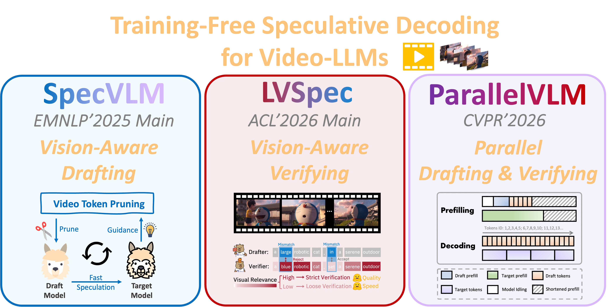
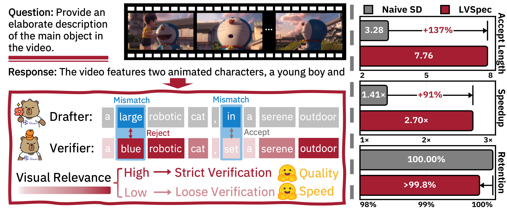
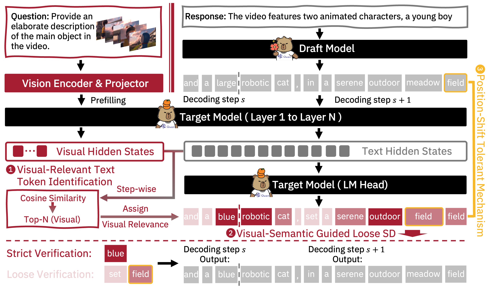

<div align="center">
<h1>
      
    <br>  
    <em>LVSpec</em>  
    <br>  
</h1>

<p align="center">
<a href="https://arxiv.org/abs/2604.05650">
  </a> 
<a href="https://openreview.net/forum?id=ABTGbAZZwL">
  </a> 
<a href="https://opensource.org/licenses/Apache-2.0">
  </a> 
<a href="https://github.com/zju-jiyicheng/LVSpec/pulls">
    </a>
</p>

<h2 style="color: #6a5acd; font-weight: bold;">
🚀 Vision-Aware Verification with Improved Upper Bound
</h2>

</div>

## Paddle adaptation

This repository adds a native Paddle inference backend to
[the upstream LVSpec project](https://github.com/zju-jiyicheng/LVSpec).
The local five-video, two-A100 test measured **2.19× decoding throughput** and
**1.63× throughput including prefill** relative to the same Paddle AR baseline.
Answer quality is not established as lossless; these results are not a controlled
Paddle-versus-PyTorch framework comparison.

- [Setup and inference](docs/PADDLE.md)
- [Delivery report: implementation and optimization](docs/DELIVERY_REPORT.md)
- [Comprehensive test report](docs/TEST_REPORT.md)
- [Saved test evidence and input regeneration](results/README.md)

The original paper description below documents the upstream work; its reported
paper results are separate from the local Paddle measurements above.

Yicheng Ji*, Jun Zhang*, Jinpeng Chen, Cong Wang, Lidan Shou, Gang Chen, Huan Li (* equal contribution)

## 📣 Overview
<p align="center">
  
</p>

## 🎉 News
- 2025.08: Our paper <a href="https://arxiv.org/abs/2508.16201"><span style="color:#1581CC;">"SpecVLM: Enhancing Speculative Decoding of Video LLMs via Verifier-Guided Token Pruning"</span></a> has been accepted to EMNLP 2025 Main.
- 2026.02: Our paper <a href="https://arxiv.org/abs/2603.19610"><span style="color:#1581CC;">"ParallelVLM: Lossless Video-LLM Acceleration with Visual Alignment Aware Parallel Speculative Decoding"</span></a> has been accepted to CVPR 2026.
- 2026.04: Our paper <a href="https://arxiv.org/abs/2604.05650"><span style="color:#1581CC;">"See the Forest for the Trees: Loosely Speculative Decoding via Visual-Semantic Guidance for Efficient Inference of Video LLMs"</span></a> has been accepted to ACL 2026 Main with oral nomination.
- 2026.04: Our paper <a href="https://arxiv.org/abs/2604.05546"><span style="color:#1581CC;">"Efficient Inference for Large Vision-Language Models: Bottlenecks, Techniques, and Prospects"</span></a> has been accepted to ACL 2026 Findings.


<p align="center">
  
</p>

## 📖 Abstract
Video Large Language Models (Video-LLMs) excel in video understanding but suffer from high inference latency due to autoregressive generation. Speculative Decoding (SD) mitigates this by applying a draft-and-verify paradigm, yet existing methods are constrained by rigid exact-match rules, severely limiting the acceleration potential. To bridge this gap, we propose LVSpec, the first training-free loosely SD framework tailored for Video-LLMs. Grounded in the insight that generation is governed by sparse visual-relevant anchors (mandating strictness) amidst abundant visual-irrelevant fillers (permitting loose verification), LVSpec employs a lightweight visual-relevant token identification scheme to accurately pinpoint the former. To further maximize acceptance, we augment this with a position-shift tolerant mechanism that effectively salvages positionally mismatched but semantically equivalent tokens. Experiments demonstrate that LVSpec is high-fidelity and rapid: it preserves $>99.8$% of target performance while accelerating Qwen2.5-VL-32B by $2.70 \times$ and LLaVA-OneVision-72B by $2.94 \times$. Notably, it boosts the mean accepted length and speedup ratio by $136$% and $35$% compared to SOTA training-free SD methods for Video-LLMs. Code is provided in the submitted software.


## 📌  Method
<p align="center">
  
</p>


## ⚙️ Environment Setup

Install the required dependencies:
```bash
conda create -n lvspec python==3.10 -y
conda activate lvspec
pip install torch torchvision
pip install -r requirements.txt
```


## 🛠 Download Models & Datasets
- [For LLaVA-OneVision models](https://huggingface.co/llava-hf)
- [For Qwen2.5-VL models](https://huggingface.co/Qwen)
- [For VideoDetailCaption dataset](https://huggingface.co/datasets/lmms-lab/VideoDetailCaption)
- [For lmm-eval evaluation](https://github.com/EvolvingLMMs-Lab/lmms-eval)


## 🚀 Quick Inference
### Paddle backend

Native Paddle video inference is available for Qwen2.5-VL and LLaVA-OneVision,
including AR, SpecVLM, LVSpec and LVSpec+PST. See [Paddle setup and validation](docs/PADDLE.md)
for dependencies, weight loading, GPU placement, supported inputs and verification.

```bash
METHOD=lvspec bash run_qwenvl_paddle.sh
# Equivalent entry point: python inference.py --backend paddle --help
```

Run the demo script to quickly evaluate LVSpec:
```bash
# Qwen2.5-VL
sh run_qwenvl.sh

# LLaVA-OneVision
sh run_llava.sh
```
We support autoregressive, naive speculative decoding, SpecVLM, and LVSpec inference.
Please also modify the model path, data path, pruning ratio, and frame number in the `.sh` file.

After running the script, the output and efficiency metric will be stored in the `save_path`.

To compare full-input autoregressive decoding with LVSpec, run both on the same
samples, GPU configuration, frame count, and generation limit:

```bash
METHOD=ar bash run_qwenvl.sh
METHOD=lvspec bash run_qwenvl.sh
python compare_speed.py \
  --baseline 'results/{qwen2_5_vl}_{ar}_drop{0.9}_frame{64}' \
  --accelerated 'results/{qwen2_5_vl}_{lvspec}_drop{0.9}_frame{64}' \
  --output results/speed_comparison.json
```

The AR branch uses the target model's full visual input; `drop_rate` only affects
the speculative draft input.

The throughput speedup is `(LVSpec total tokens / LVSpec total decoding time)`
divided by `(AR total tokens / AR total decoding time)`, using the repository's
token counters. This measures decoding only, excluding prefill and video
preprocessing. The report also includes the decoding time ratio; output lengths
can differ between methods. This timing comparison does not measure answer quality.


## 🚀 Benchmark Evaluation
We use [lmm-eval](https://github.com/EvolvingLMMs-Lab/lmms-eval) to evaluate the performance metric on `VideoDetailCaption`, `VideoDetailDescription`, `MovieChat`, and `Video-MME`. You may take the following steps:

```bash
# Clone lmm-eval and install the dependancies.
git clone https://github.com/EvolvingLMMs-Lab/lmms-eval.git
```

1. Put the file `evaluation/llava_onevision_lvspec.py` and `evaluation/qwen2_5_vl_lvspec.py` under `lmms-eval/lmms_eval/models/` and modify `lmms-eval/lmms_eval/models/__init__.py` to register. Also put the two `.sh` file under `lmms-eval/examples/models`.

2. To make sure the LVSpec repository is accessible in lmm-eval, you can clone the LVSpec repo to `lmms-eval/lmms_eval`.

3. Modify the corresponding configs in `/lmms-eval/lmms_eval/tasks`. Then launch the LLM judge as in `LVSpec/evaluation/sglang.sh`.

```bash
# In lmm-eval
# llava-onevision
bash examples/models/llava_onevision_specvlm.sh

# qwen2.5-vl
bash examples/models/qwen25vl_specvlm.sh
```
After running, both the performance metric and efficiency metric will be recorded.

We recommand using `quick inference` for quick testing, and using `benchmark evaluation` to reproduce the results in the paper. Because running within lmm-eval enables support for vLLM, standard benchmark configurations, and qwen-vl-utils.


## 🛩️ Future Work
- [ ] Explore vision-aware drafting structures.
- [ ] Adapt to complex visual reasoning scenarios.
- [ ] Explore design in the training phase.


## Note
- Our method primarily targets resource-constrained long-video scenarios, where GPU memory bandwidth constitutes the main bottleneck during inference. Hence, the speedup ratio is sensitive to hardware settings.
Users are advised to set the input length according to GPU capacity. Theoretically, as frame number grows, SpecVLM and LVSpec achieve higher acceleration ratios.
- Our LVSpec is built upon the repository of [SpecVLM](https://github.com/zju-jiyicheng/SpecVLM). To focus on studying the effect of vision-aware verification, we apply simple uniform visual token pruning.

## Citation
If you find our work useful or relevant to your research, please kindly cite our papers:
```bibtex
@inproceedings{ji2025specvlm,
  title={Specvlm: Enhancing speculative decoding of video llms via verifier-guided token pruning},
  author={Ji, Yicheng and Zhang, Jun and Xia, Heming and Chen, Jinpeng and Shou, Lidan and Chen, Gang and Li, Huan},
  booktitle={Proceedings of the 2025 Conference on Empirical Methods in Natural Language Processing},
  pages={7216--7230},
  year={2025}
}

@misc{ji2026foresttreeslooselyspeculative,
  title={See the Forest for the Trees: Loosely Speculative Decoding via Visual-Semantic Guidance for Efficient Inference of Video LLMs},
  author={Yicheng Ji and Jun Zhang and Jinpeng Chen and Cong Wang and Lidan Shou and Gang Chen and Huan Li},
  year={2026},
  eprint={2604.05650},
  archivePrefix={arXiv},
  primaryClass={cs.CL},
  url={https://arxiv.org/abs/2604.05650}
}

@article{kong2026parallelvlm,
  title={ParallelVLM: Lossless Video-LLM Acceleration with Visual Alignment Aware Parallel Speculative Decoding},
  author={Kong, Quan and Shen, Yuhao and Ji, Yicheng and Li, Huan and Wang, Cong},
  journal={arXiv preprint arXiv:2603.19610},
  year={2026},
  url={https://arxiv.org/abs/2603.19610}
}

@misc{zhang2026efficientinferencelargevisionlanguage,
      title={Efficient Inference for Large Vision-Language Models: Bottlenecks, Techniques, and Prospects}, 
      author={Jun Zhang and Yicheng Ji and Feiyang Ren and Yihang Li and Bowen Zeng and Zonghao Chen and Ke Chen and Lidan Shou and Gang Chen and Huan Li},
      year={2026},
      eprint={2604.05546},
      archivePrefix={arXiv},
      primaryClass={cs.CL},
      url={https://arxiv.org/abs/2604.05546}, 
}

```
